# dora-ict-register

dora-ict-register lee un registro CSV de acuerdos con terceros proveedores de TIC (`provider,lei,function,criticality,subcontractors,exit_plan,audit_right,data_location,contract_end`) y comprueba lo que DORA espera de los proveedores que sustentan funciones críticas o importantes: plan de salida documentado, derechos de auditoría y acceso, un identificador LEI válido, subcontratistas declarados, ubicación de los datos conocida y un contrato vigente. Cada hallazgo apunta a la línea del CSV.



**Demo en vivo:** https://jvch0512.github.io/dora-ict-register/ (datos sintéticos)

## Uso

```bash
make build
build/dora-ict-register examples
build/dora-ict-register registro.csv --tsv
build/dora-ict-register registro.csv --fail-on high
```

Códigos de salida: 0 correcto, 1 hallazgos iguales o superiores a `--fail-on`, 2 entrada no válida. La salida es texto por defecto y TSV con `--tsv`; también hay SARIF mediante `scripts/tsv2sarif.py`.

| Regla | Severidad | Qué detecta |
|---|---|---|
| DOR001 | alta | proveedor de una función crítica o importante sin plan de salida documentado (`exit_plan` distinto de `yes`) |
| DOR002 | alta | proveedor crítico o importante sin derechos de auditoría y acceso (`audit_right` distinto de `yes`) |
| DOR003 | media | identificador ausente o que no es ni un LEI válido (20 caracteres, dígitos de control ISO 17442) ni un EUID |
| DOR004 | media | proveedor crítico o importante cuya `data_location` no es un código de país del EEE, `EU` o `EEA` |
| DOR005 | media | proveedor crítico o importante sin subcontratistas declarados (escriba `none` si no hay) |
| DOR006 | media o baja | contrato vencido (media) o que vence en 90 días o menos (baja), con `--today AAAA-MM-DD` o la fecha del sistema |
| DOR007 | baja | `criticality` vacía o distinta de `critical`, `important` o `standard` |
| DOR000 | info | fichero vacío o sin columnas `provider` y `criticality` |

## Límites

- Revisa un fichero de registro, no contratos. Un `yes` en `exit_plan` se acepta tal como está escrito.
- Las funciones críticas o importantes se toman de la columna `criticality`; la herramienta no las clasifica.
- El LEI se valida por formato y dígitos de control (ISO 7064 mod 97-10). No consulta la base de datos de GLEIF para saber si está activo.
- La lista del EEE incluye los 27 Estados de la UE más Islandia, Liechtenstein y Noruega. No modela decisiones de adecuación de otros países.
- Es una ayuda a la revisión y no constituye asesoramiento jurídico.

## Dónde encaja

Revisar el registro de información que las entidades financieras deben mantener bajo DORA, antes de que lo pida un supervisor o un auditor. Las plantillas del registro están en el Reglamento de Ejecución (UE) 2024/2956.

## Pruebas

```bash
make test
```

## Más información

- Código abierto bajo licencia MIT. Seguridad: [SECURITY.md](SECURITY.md).
- Validación con datos reales: [docs/validation.md](docs/validation.md) (en inglés).
- Versión en inglés: [README.md](README.md).
