# dora-ict-register

[Español](README.es.md)

dora-ict-register reads a CSV register of ICT third-party arrangements (`provider,lei,function,criticality,subcontractors,exit_plan,audit_right,data_location,contract_end`) and checks what the DORA regulation expects for providers that support critical or important functions: a documented exit plan, audit and access rights, a valid Legal Entity Identifier, declared subcontractors, a known data location and a contract that has not expired. Findings point at the CSV line of the provider.



**Live demo:** https://jvch0512.github.io/dora-ict-register/ (Synthetic data.)

Standard ML (Poly/ML 5.7), no libraries. The demo page is rendered from the tool's `--tsv` output by `scripts/site.py` (Python 3, only needed to regenerate the page).

## Use

```bash
make build
build/dora-ict-register examples
build/dora-ict-register register.csv --tsv
build/dora-ict-register register.csv --fail-on high       # exit 1 on any high finding
```

Exit codes: 0 ok, 1 findings at or above `--fail-on`, 2 bad input. Output is human text by default and TSV with `--tsv` (`# N files, M findings`, then `SEVERITY<TAB>RULE<TAB>WHERE<TAB>MESSAGE`).

| Rule | Severity | What it catches |
|---|---|---|
| DOR001 | high | a provider of a critical or important function has no documented exit plan (`exit_plan` is not `yes`) |
| DOR002 | high | a critical or important provider without audit and access rights (`audit_right` is not `yes`) |
| DOR003 | medium | the provider identifier is missing or is neither a valid LEI (20 characters, ISO 17442 check digits) nor an EUID |
| DOR004 | medium | a critical or important provider whose `data_location` is not an EEA country code, `EU` or `EEA` |
| DOR005 | medium | a critical or important provider with no declared subcontractors (write `none` if there are none) |
| DOR006 | medium or low | the contract has ended (medium) or ends in 90 days or less (low), using `--today YYYY-MM-DD` or the system date |
| DOR007 | low | the `criticality` is empty or not `critical`, `important` or `standard` |
| DOR000 | info | the file is empty or has no `provider` and `criticality` columns |

See [examples](examples) and [docs/sample-output.txt](docs/sample-output.txt).

## Limits

- It checks a register file, not contracts. A `yes` in `exit_plan` is trusted as written.
- Critical or important functions are taken from the `criticality` column; the tool does not classify functions itself.
- The EEA list covers the 27 EU states plus Iceland, Liechtenstein and Norway. Adequacy decisions for other countries are not modelled.
- Quoted fields may contain commas but not line breaks.
- It supports review work and is not legal advice.

## Where it fits

Reviewing the register of information that financial entities must keep under DORA, before a supervisor or an auditor asks for it.

## Tests

```bash
make test    # An SML test program: every rule on good and bad rows, CSV quoting, date arithmetic, hostile input, fuzzing and CLI exit codes
```

MIT.

## Code scanning (SARIF)

`scripts/tsv2sarif.py` converts the `--tsv` output into SARIF 2.1.0, so findings show up in GitHub code scanning:

```sh
build/dora-ict-register examples --today 2026-11-16 --tsv | python3 scripts/tsv2sarif.py --tool dora-ict-register --prefix examples > results.sarif
```

Upload `results.sarif` with `github/codeql-action/upload-sarif`. Severities map to SARIF levels (critical and high to error, medium to warning, low and info to note) and to a `security-severity` score.

## Validated on real data

This tool was run on public corpora and the false positives it produced were fixed. Corpus, counts and bugs found are in [docs/validation.md](docs/validation.md).
